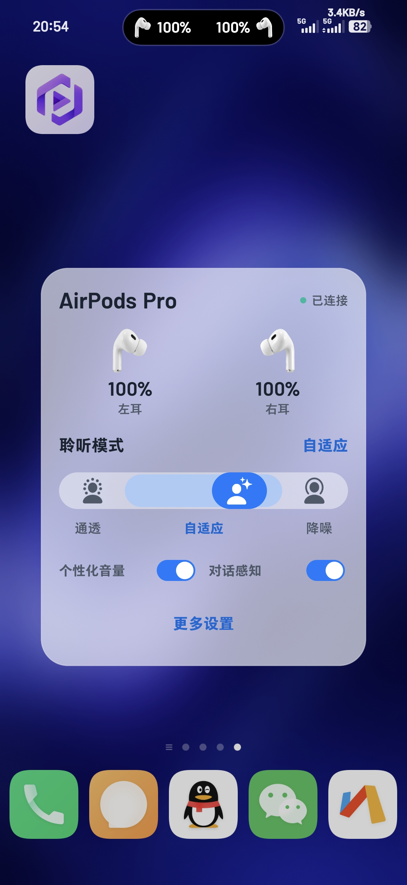

# HyperPods HyperOS 4 · 构建 33

版本 `3.0.0-AAP-W-HyperOS4`，构建号 **33**。

## 本次更新

- 点击耳机通知或超级岛，可打开居中的磨砂悬浮窗。磨砂随当前页面背景变化，支持开关动效。
- 悬浮窗可查看左右耳及已同步的充电仓电量，切换聆听模式、调节自适应强度，以及开关个性化音量和对话感知。「更多设置」直达首页。
- 优化超级岛点击后的收起动效。等待耳机状态同步时，滑块以灰色显示。升级后若仍加载旧模块，首页会提示重启对应的 LSPosed 作用域进程。

